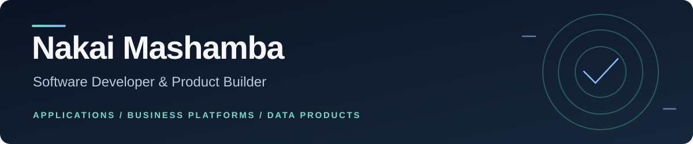

**Applications · Business Platforms · Data Products**

[**Selected work**](#selected-work) · [**Connect on LinkedIn**](https://zw.linkedin.com/in/nakaimashamba)

## Turning complex ideas into practical software.

I design and develop **applications and digital products**, bringing together the architecture, business logic and user experience that make software useful.

My work spans **business-management platforms, accounting and financial workflows, vendor administration, APIs, databases, interfaces and data-driven tools**. With a background in **Industrial and Manufacturing Engineering**, I approach development by understanding how the whole process works—not only what appears on the screen.

My strongest hands-on work is currently in full-stack and business application development. I'm also expanding into **mobile and cross-platform apps** as the next part of that journey.

---

## Selected work

### 01 · Education & Financial Operations Platform

**Business systems · Accounting · Multi-tenant workflows**  
`Python` · `Django REST Framework` · `Next.js` · `TypeScript` · **In development**

Working with partners on an education and business-management platform. Its accounting foundation implements **balanced journal entries, controlled posting and reversals, financial-period checks and organisation-scoped reporting**.

The interesting part isn't just the dashboard: it's making sure operational and financial workflows follow consistent rules.

**[Explore the engineering case →](./work/education-accounting.md)**

---

### 02 · Approved Vendor List (AVL) Platform

**Vendor lifecycle · Review and approval · Controlled publication**  
`Python` · `Django REST Framework` · `Next.js` · `TypeScript` · **Private platform work**

A vendor administration system with distinct stages for application capture, supporting evidence, review, activation and public listing. The software separates **internal decisions and private records** from the information permitted in a public directory.

**[Explore the workflow case →](./work/approved-vendor-list.md)**

---

### 03 · Financial Application Workflow

**Application journeys · Repayment schedules · Operational reporting**  
`Next.js` · `TypeScript` · **Fictional-data prototype**

An interactive lending workflow demonstration covering application stages, decisions, schedules, repayment allocation and reporting states. This is a software prototype using simulated records, not an operational lending service.

---

### 04 · CareSignal

**Full-stack workflow · Deterministic rules · Human review**  
`Next.js` · `FastAPI` · `Python` · `TypeScript` · **Public synthetic-data prototype**

A confirmation-led workflow in which provisional submissions are kept separate from confirmed records, followed by rule-based tasks and human-reviewed responses. It demonstrates application and backend design; it is **not a clinical service**.

**[Explore the source code →](https://github.com/NK05/caresignal-demo)**

---

## What I work across

| Applications & product development | Systems & data |
| :--- | :--- |
| Full-stack applications and portals | Backend services and REST APIs |
| Interfaces and user journeys | SQL databases and reporting |
| Business workflow and product design | Data analysis and practical decision tools |
| Iterative development and integration | Domain validation and software testing |

**Technologies:** Python · Django/DRF · FastAPI · JavaScript/TypeScript · React/Next.js · SQL · PostgreSQL · Git · Power BI

**Exploring next:** Mobile and cross-platform application development.

## Beyond the code

My work also involves product planning, technology leadership and collaboration. I've helped lead innovation activities, including a hackathon programme in collaboration with NUST's Innovation and Business Development department, and have been involved in data-science mentoring through ALX.

I enjoy working where technical decisions meet real operational needs—and where a good software product depends on understanding the people who will use it.

## Let's connect

I'm open to conversations about **custom software, full-stack applications, product development, data-driven solutions and collaborative projects**.

**[Connect with me on LinkedIn →](https://zw.linkedin.com/in/nakaimashamba)**

Some projects are private or in development. These summaries describe bounded, demonstrable work; code, sensitive client information and unreleased product details stay private. Product demonstrations will be added as they are prepared.
