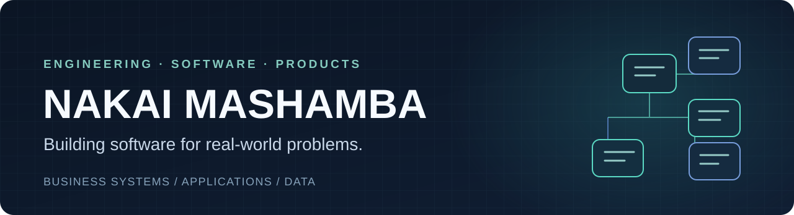

**SOFTWARE DEVELOPER & PRODUCT BUILDER** · **INDUSTRIAL & MANUFACTURING ENGINEER**

## I build software systems, not just websites.

I work on the **design and development of applications, business platforms and data-driven tools** — from understanding a real operational problem to shaping the product, building interfaces and APIs, and defining the rules that make a system dependable.

My background in **Industrial and Manufacturing Engineering** gives me a systems perspective. I think about processes, people, constraints, controls and the decisions software needs to support. That has led me to work on education and accounting systems, vendor administration, financial workflows and full-stack application prototypes.

My current implementation experience is strongest across **web applications, backend services and business systems**. I'm extending that work into **mobile and cross-platform application development**; I don't present unbuilt mobile products as delivered work.

---

## Selected systems and product work

*These are high-level case notes for substantive work. The commercial and client code remains private; descriptions focus on the problem and engineering contribution without exposing proprietary product designs or real records.*

### 01 / Education operations & accounting platform

**Business software · Multi-tenant architecture · Accounting controls**  
`Python` · `Django REST Framework` · `Next.js` · `TypeScript` · `PostgreSQL-ready` · **In development**

Working with partners on a modular education and business-management platform. My involvement includes product planning, application architecture and development. Its accounting foundation includes **balanced journal entries, controlled posting and reversals, financial-period checks and organisation-scoped reporting** — the sort of correctness that matters behind an apparently simple dashboard.

**[Read the engineering case note →](./work/education-accounting.md)**

### 02 / Approved Vendor List (AVL) platform

**Business process automation · Review workflows · Access control**  
`Python` · `Django REST Framework` · `Next.js` · `TypeScript` · **Private platform work**

Developing an administration workflow where vendor applications, supporting evidence, internal decisions and publication are **separate, controlled steps**. The challenge is not just listing vendors; it is ensuring that **only approved information** becomes public while internal records and permissions remain protected.

**[Read the workflow case note →](./work/approved-vendor-list.md)**

### 03 / Financial application and lending workflow prototypes

**Application journeys · Repayment logic · Operational interfaces**  
`TypeScript` · `Next.js` · **Fictional-data demonstration**

Work on interactive financial-service workflows covering application stages, repayment schedules, allocation logic and reporting. The inspected prototype uses fictional records and simulated actions, **not a live lending backend**.

### 04 / CareSignal — public full-stack prototype

**Confirmation-led workflows · Backend logic · Human review**  
`Next.js` · `FastAPI` · `Python` · `TypeScript` · **Synthetic, nonclinical prototype**

A public code example demonstrating how unconfirmed input is kept separate from authoritative records, with rule-based review tasks and human-approved responses. It is a technical workflow demonstration, **not a medical device or clinical service**.

**[Explore the public repository and source →](https://github.com/NK05/caresignal-demo)**

---

## What I bring to a software project

| Product and systems work | Data and engineering thinking |
| :--- | :--- |
| Requirements and workflow modelling | Business process analysis |
| Full-stack application development | Data modelling and reporting |
| APIs, databases and backend logic | Python, SQL and exploratory analytics |
| Interfaces, dashboards and user journeys | Testing, validation and operational controls |
| Iterative product development | Collaboration, technical leadership and mentoring |

**Tools I work with:** Python · Django/DRF · FastAPI · JavaScript/TypeScript · React/Next.js · SQL · PostgreSQL · Git · Power BI.

Beyond development, my experience includes **technology leadership, ALX data-science mentoring**, and leading a hackathon programme in collaboration with **NUST's Innovation and Business Development team**. Those experiences influence how I work with users, stakeholders and technical teams.

## Currently building toward

More sophisticated business software, integrated platforms, useful data products and **mobile applications** — with an emphasis on systems that genuinely solve operational problems rather than simply look impressive.

I'm interested in **custom software projects, freelance collaborations, software engineering opportunities and practical product partnerships**.

**[Connect on LinkedIn →](https://zw.linkedin.com/in/nakaimashamba)**

Some work is private or in development. The case notes are deliberately scoped and do not claim deployments, customer adoption or features beyond the evidence available.
