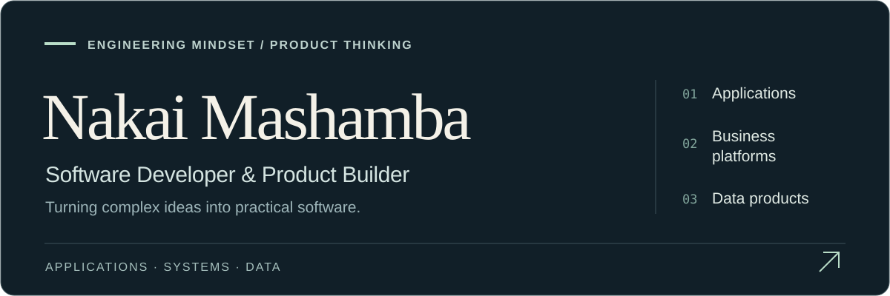
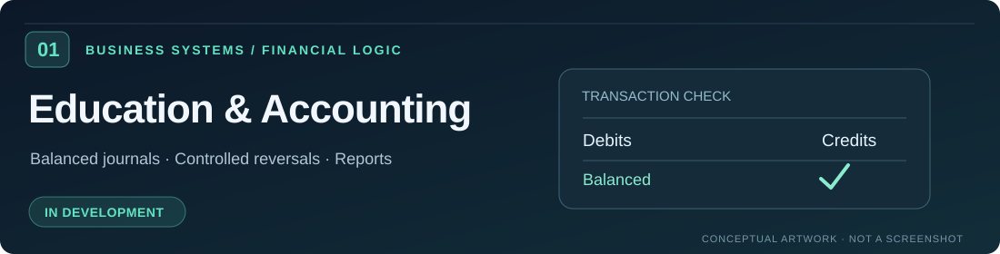
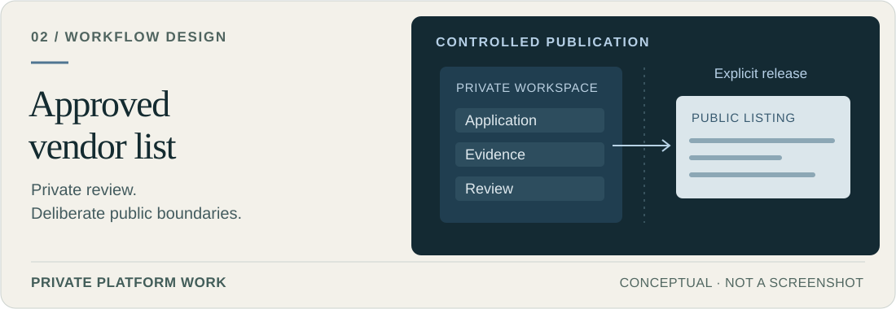
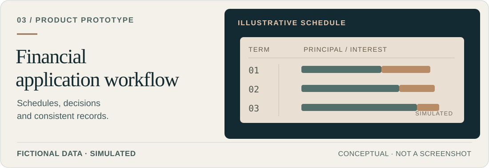
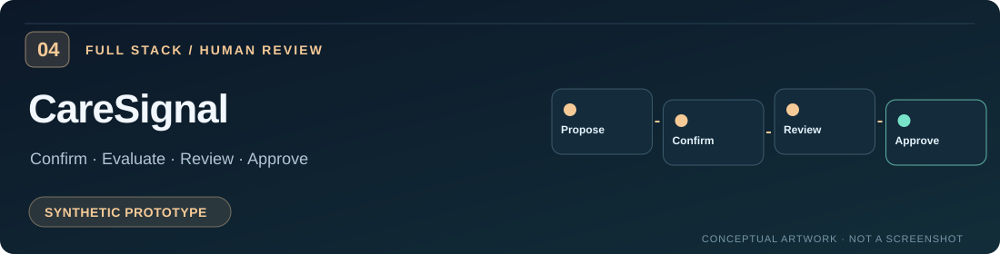

  

  <a href="#selected-work">Explore selected work</a> · <a href="#what-i-work-across">What I do</a> · <a href="https://zw.linkedin.com/in/nakaimashamba">Connect on LinkedIn</a>

I design and develop **applications, business platforms and data-driven products**, from the first conversations about a problem to the architecture, interfaces and logic that bring a solution together.

My background in **Industrial and Manufacturing Engineering** influences how I work: understand the process, think through the constraints and build the pieces into a system that makes sense. My experience spans **accounting and education platforms, vendor administration, financial workflows, full-stack applications and analytics**.

I enjoy both sides of development: the technical detail behind a system and the decisions that make it useful to real people.

## Selected work

### 01 / Education & Financial Operations

**The challenge:** Build reliable operational and financial workflows for an education/business platform.

**My work:** Product and application development with partners, including backend accounting foundations for **balanced journals, controlled posting and reversals, financial-period checks and organisation-scoped reporting**.

`Python` · `Django REST Framework` · `Next.js` · `TypeScript` · *In development*

**[Explore the engineering case →](./work/education-accounting.md)**

### 02 / Approved Vendor List Platform

**The challenge:** Manage vendor applications and approvals without mixing private administrative records with public listings.

**My work:** Development of structured **application, evidence-review, activation and publication workflows**, with role-based controls and a deliberately limited public directory.

`Python` · `Django REST Framework` · `Next.js` · `TypeScript` · *Private platform work*

**[Explore the workflow case →](./work/approved-vendor-list.md)**

### 03 / Financial Application Workflow

**The challenge:** Make a multi-stage financial journey understandable, with consistent schedules, decisions and records.

**My work:** An interactive application prototype covering lending stages, **repayment schedules, allocation logic and reporting views**, using fictional data and simulated operations.

`Next.js` · `TypeScript` · *Interactive prototype*

### 04 / CareSignal — Full-Stack Prototype

**The challenge:** Keep incoming information provisional until it is confirmed, then coordinate a traceable review process.

**My work:** A public full-stack prototype with **confirmation-gated records, deterministic rule evaluation, review tasks and human-controlled responses**.

`Next.js` · `FastAPI` · `Python` · `TypeScript` · *Synthetic, nonclinical demonstration*

**[Explore the source code →](https://github.com/NK05/caresignal-demo)**

## What I work across

| Applications & products | Backend, data & engineering |
| :--- | :--- |
| Full-stack applications and digital platforms | APIs, services and business logic |
| User portals, dashboards and workflows | Databases, reporting and SQL |
| Product architecture and iterative development | Validation, testing and system boundaries |
| Business process and requirements analysis | Data analysis and practical decision tools |

**Core technologies:** Python · Django/DRF · FastAPI · JavaScript/TypeScript · React/Next.js · PostgreSQL · SQL · Git · Power BI

**Where I'm growing:** Mobile and cross-platform application development, alongside more capable business and data products.

## Beyond the code

I've worked across technical development, product planning and collaboration, including technology leadership, **ALX data-science mentoring** and leading a hackathon programme in collaboration with **NUST's Innovation and Business Development department**.

That mix of engineering, business understanding and working with people is central to how I approach a project.

## Let's build something useful

I'm interested in **custom software, applications, product development, data-driven solutions and thoughtful technical collaborations**.

**[Connect with me on LinkedIn →](https://zw.linkedin.com/in/nakaimashamba)**

Portfolio artwork is conceptual, not an application screenshot. Selected work includes private and in-development projects; sensitive source and client records stay private. Verified product demonstrations will be added progressively.
